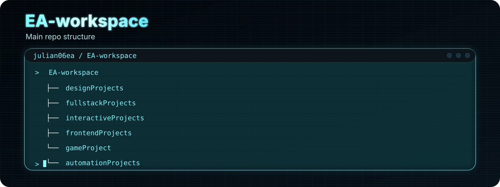

<h3>About me</h3>

 

<a href="https://github.com/julian06ea/EA-worjects">Design</a>
&nbsp;•&nbsp;
<a href="https://github.com/julian06ea/EA-worProjects">Fullstack</a>
&nbsp;•&nbsp;
<a href="https://github.com/julian06ea/EA-worveProjects">Interactive</a>
&nbsp;•&nbsp;
<a href="https://github.com/julian06ea/EA-worrojects">Frontend</a>
&nbsp;•&nbsp;
<a href="https://github.com/julian06ea/EA-worcts">Games</a>
&nbsp;•&nbsp;
<a href="https://github.com/julian06ea/EA-wornProjects">Automation</a>

